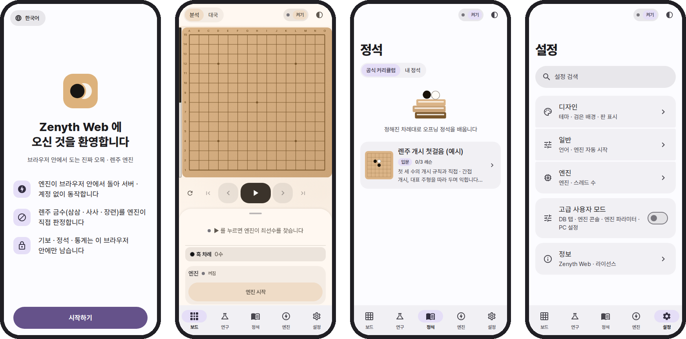

<div align="center">

<picture>
  <source media="(prefers-color-scheme: dark)" srcset="docs/readme/logo/zenyth-web-lockup-dark.svg">
  <source media="(prefers-color-scheme: light)" srcset="docs/readme/logo/zenyth-web-lockup-light.svg">
  
</picture>

<p>
  <b>A championship-level gomoku and renju engine, running entirely in your browser.</b><br>
  Play, analyse, review and research. No server, no install, no account.
</p>

<p>
  <a href="https://github.com/lowqen/Zenyth-web/actions/workflows/web.yml"></a>
  <a href="https://github.com/lowqen/Zenyth-web/actions/workflows/deploy.yml"></a>
  <a href="LICENSE"></a>
  
</p>

</div>

<p align="center">
  <a href="https://zenythweb.pages.dev">
    <picture>
      <source media="(prefers-color-scheme: dark)" srcset="docs/readme/badges/open-dark.svg">
      
    </picture>
  </a>
  <a href="https://github.com/lowqen/Zenyth">
    <picture>
      <source media="(prefers-color-scheme: dark)" srcset="docs/readme/badges/android-dark.svg">
      
    </picture>
  </a>
  <a href="README.ko.md">
    <picture>
      <source media="(prefers-color-scheme: dark)" srcset="docs/readme/badges/readme-ko-dark.svg">
      
    </picture>
  </a>
</p>

## <picture><source media="(prefers-color-scheme: dark)" srcset="docs/readme/sections/screenshots-dark.svg"></picture> Screenshots

<picture>
  <source media="(prefers-color-scheme: dark)" srcset="docs/readme/showcase-dark.png">
  
</picture>

<p align="center"><sub>Shown in Korean on a phone, light theme. The site speaks English and Korean, and follows the system's dark theme.</sub></p>

---

## Why Zenyth Web?

[Rapfi](https://github.com/dhbloo/rapfi) is one of the strongest open-source Gomoku/Renju engines,
a C++ engine with NNUE evaluation. Zenyth Web compiles it to **WebAssembly** and
wraps it in a full analysis workbench. A desktop GUI, an Android app and a server farm, all
inside one browser tab.

- **Nothing leaves your device.** Games, reviews, databases and statistics live in IndexedDB.
- **Works anywhere static files can be hosted.** No backend, no API keys, no telemetry.
- **Fast.** Multi-threaded SIMD search, ~20 MB of network weights cached after the first visit.

## <picture><source media="(prefers-color-scheme: dark)" srcset="docs/readme/sections/features-dark.svg"></picture> Key Features

### <picture><source media="(prefers-color-scheme: dark)" srcset="docs/readme/features/engine-dark.svg"></picture> Multi-threaded C++ engine in WebAssembly
- Rapfi compiled with Emscripten into **four variants**: `{single, multi}-thread × {SIMD128, Relaxed SIMD}`.
  The app probes the browser and boots the fastest one, falling back step by step.
- Pthreads on `SharedArrayBuffer` when the page is cross-origin isolated (COOP/COEP), with a
  time-sliced single-threaded fallback everywhere else.
- Weights are fetched once, **SHA-256 verified**, and served from Cache Storage afterwards.
- Engine patches are measured, not guessed: SPRT matches, mate suites and fixed-depth benches
  run in CI. The deployed build scores **+100 Elo** over a stock Rapfi WASM build at 1 thread,
  500 ms/move ([report](docs/gomocalc-대국-분석.md)).

### <picture><source media="(prefers-color-scheme: dark)" srcset="docs/readme/features/convert-dark.svg"></picture> In-browser game archive conversion
- Drop the RenjuNet archive (`.rif`, 43 MB, ~119,000 games) **onto any screen**. A worker
  streams the bytes, hashes every position with incremental 64-bit Zobrist keys and builds a
  15 MB statistics pack.
- **3.7 s on a real Android phone (Chrome), 4.6 s on a Celeron N4500**, with 50–57 MB peak
  worker memory. Opening frequencies, rankings by player, color and rule, and game lists follow instantly.
- Verified position-for-position (116,191 positions) against the desktop toolchain's packs.

### <picture><source media="(prefers-color-scheme: dark)" srcset="docs/readme/features/review-dark.svg"></picture> Automatic game review with an 11-grade move report
- Every position is read with the top two candidates (`YXNBEST 2`); each move is graded on an
  **11-step scale** (brilliant, best, … mistake, blunder, missed win) with per-side accuracy.
- Batch queue with per-position checkpoints. Close the tab and it resumes where it stopped.
- Export to **CSV, Markdown, or a self-contained HTML report** with board, eval graph and worst moves.
- Also included: **AND/OR proof search** for forced wins, and a **move-order explorer** that
  counts every sequence reaching the current stones.

### <picture><source media="(prefers-color-scheme: dark)" srcset="docs/readme/features/storage-dark.svg"></picture> Fully client-side, persistent storage
- Games autosave on every move, undo included. Reload and keep going.
- The engine's own position **database** (yixindb) is round-tripped between Emscripten's
  in-memory FS and IndexedDB. Annotate, label, import and export `.db` and CSV.
- **Official opening curriculum**: maintainer-curated joseki you study read-only. Explore every
  branch with commentary, bad moves, traps and refutations, or switch to Learn and guess each move
  (hints, scoring, progress saved in the browser). Published as a static file, no server.
- **Joseki editor**: variation trees, Markdown notes with clickable coordinates, auto
  classification, and lookup by board position (symmetry-aware).
- Open and save `.psq`, `.sav` and `.pos`; share any position as a `?p=h8i9j10` deep link;
  import and export desktop `settings.txt` byte for byte.

### <picture><source media="(prefers-color-scheme: dark)" srcset="docs/readme/features/lang-dark.svg"></picture> Korean / English, responsive and accessible
- Full **Korean and English UI** (~900 strings) with auto-detection and a switch in Settings.
  A test scans the source so no string ships untranslated.
- **Responsive from 360 px phones to desktops**, in portrait and landscape, light and dark themes.
- **Accessibility built in**: keyboard play on every board (arrows + Enter), screen-reader
  announcements, dialogs that take focus and close on Esc, 24 px minimum touch targets, and **WCAG 4.5:1
  contrast** in both themes, all enforced by a Playwright smoke test.


## <picture><source media="(prefers-color-scheme: dark)" srcset="docs/readme/sections/architecture-dark.svg"></picture> Architecture

```
┌──────────────────────────── Browser tab (main thread) ─────────────────────────────┐
│                                                                                    │
│   React 18 UI ── Zustand stores ── Canvas 2D board (2 layers)                      │
│        │                │                                                          │
│        │                └── Dexie ──► IndexedDB  games · reviews · queue · joseki  │
│        │                                         dbfiles · packs                   │
│        │ EngineClient (typed messages, position-keyed replies)                     │
└────────┼───────────────────────────────────────────────────────────────────────────┘
         │ postMessage
┌────────▼──────────────── Engine Web Worker ───────────────────┐   ┌─ Other workers ─┐
│  engine-worker.ts                                             │   │ rif.worker      │
│    ├─ Gomocup / Yixin text protocol (sendCommand ↔ lines)     │   │  .rif → pack    │
│    ├─ weights-cache: Cache Storage + SHA-256 → rapfi.data     │   │ moveOrder.worker│
│    └─ Emscripten module (Rapfi C++ → WASM)                    │   │  sequence DAG   │
│         ├─ MEMFS  /rapfi.db  ◄── synced ──► IndexedDB         │   └─────────────────┘
│         └─ pthreads on SharedArrayBuffer (multi variants)     │
└───────────────────────────────────────────────────────────────┘
```

- **One owner per engine.** Only the worker touches the WASM module. The UI sends typed
  commands and draws a reply only if its position key matches the current board, so stale
  analysis never flashes after undo.
- **Exclusive modes.** Play, analysis, review and proof share one engine through a lock, and
  each mode knows how to yield.
- **Variant fallback.** relaxed multi → multi → relaxed single → single, decided by capability
  probes and a warm-up handshake. Browsers without WASM SIMD get a clear notice.

| Layer | Tech |
|---|---|
| UI | React 18, React Router 6, Zustand 5, Canvas 2D, design tokens generated from TS |
| Engine | Rapfi (C++) → Emscripten → WASM SIMD128 / Relaxed SIMD, pthreads |
| Storage | IndexedDB via Dexie 4, Cache Storage for weights |
| Quality | TypeScript strict, Vitest (50+ test files), Playwright smoke tests, ESLint, Prettier |
| Delivery | GitHub Actions → Cloudflare Pages (COOP/COEP headers for threads) |

## <picture><source media="(prefers-color-scheme: dark)" srcset="docs/readme/sections/start-dark.svg"></picture> Quick Start

**Requirements:** Node.js ≥ 20.11 (CI uses 26) and pnpm.

```bash
git clone https://github.com/lowqen/Zenyth-web.git
cd Zenyth Web
pnpm install

# Engine weights (~20 MB) are a release asset, not part of git.
# The tag must match src/engine/engine-manifest.json.
gh release download engine-3c94c2a9-w8 --dir public/engine --pattern 'rapfi.data'

pnpm dev          # http://localhost:5173
```

Without `rapfi.data` the UI still runs; the engine indicator simply reports an error.

| Command | What it does |
|---|---|
| `pnpm dev` | Generate design tokens and start the Vite dev server |
| `pnpm build` | Tokens, type check, production build into `dist/` |
| `pnpm preview` | Serve the production build locally |
| `pnpm test` | Unit tests (Vitest) |
| `pnpm check` | Type check, lint, test, format check and build: what CI checks (tsc, ESLint and Prettier keep caches, so repeat runs are fast) |
| `pnpm check:quick` | Before a commit: type check, lint, format, and only the tests affected by your changes (CI still runs everything) |
| `pnpm engine:build` | Rebuild the WASM engine from source (Linux x86_64, Emscripten) |

Deployment to Cloudflare Pages is automated by [`deploy.yml`](.github/workflows/deploy.yml);
see [`docs/배포-cloudflare.md`](docs/배포-cloudflare.md) for the one-time setup.

### Browser support

WebAssembly SIMD and the CSP keyword `'wasm-unsafe-eval'` are required: **Chrome/Edge 97+, Firefox 102+,
Safari 16.4+**. Multi-threading
additionally needs cross-origin isolation (`public/_headers`). On hosts without it, Zenyth Web falls
back to the single-threaded engine automatically.

This web build ships **Renju** weights only (Cloudflare's 25 MB per-file limit).

## <picture><source media="(prefers-color-scheme: dark)" srcset="docs/readme/sections/docs-dark.svg"></picture> Documentation

| Document | Contents |
|---|---|
| [`docs/기능-안내.md`](docs/기능-안내.md) | Detailed feature guide, screen by screen (Korean) |
| [`docs/최적화-마스터플랜.md`](docs/최적화-마스터플랜.md) | Engine optimization log: every patch, its measurement and verdict |
| [`docs/gomocalc-대국-분석.md`](docs/gomocalc-대국-분석.md) | Match analysis behind the +100 Elo figure |
| [`public/engine/README.md`](public/engine/README.md) | Engine variants, build provenance, weight caching |

## <picture><source media="(prefers-color-scheme: dark)" srcset="docs/readme/sections/licence-dark.svg"></picture> License & data

Zenyth Web is released under the **[GNU GPL v3.0 or later](LICENSE)** because the bundle includes the
Rapfi engine. Code written for this repository may also be used under BSD 2-Clause. Bundled and
ported components (Rapfi, rapfi-networks, Yixin-Board, Zenyth, npm dependencies) are listed in
[**THIRD_PARTY_NOTICES.md**](THIRD_PARTY_NOTICES.md), together with where to find the engine's
corresponding source.

**RenjuNet data is never bundled.** Its license permits non-commercial, offline use only, so the
app processes *your* local copy inside *your* browser and nothing is uploaded. `.gitignore` and a CI
gate keep `.rif`-derived files out of the repository and every deployment.

## <picture><source media="(prefers-color-scheme: dark)" srcset="docs/readme/sections/credits-dark.svg"></picture> Acknowledgements

- [**dhbloo/rapfi**](https://github.com/dhbloo/rapfi) and [**rapfi-networks**](https://github.com/dhbloo/rapfi-networks): the engine and its networks
- [**Yixin-Board**](https://github.com/accreator/Yixin-Board) by Kai Sun, and [dhbloo's fork](https://github.com/dhbloo/Yixin-Board): the desktop GUI whose protocol and review logic this app follows
- [**Zenyth**](https://github.com/lowqen/Zenyth): the Android analysis board this web app was ported from
